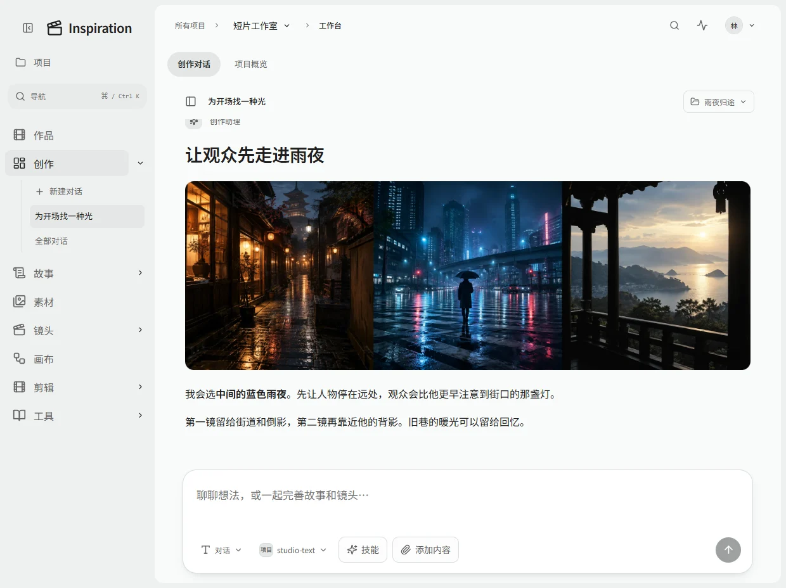
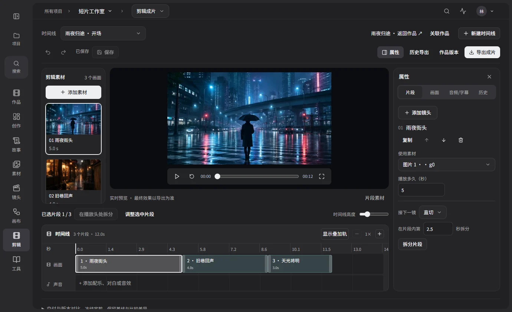

# Inspiration

**一款可以和 AI 一起做片、也可以自己接手剪辑的视频创作工作台。** 在同一个项目里写剧本、找参考、做分镜，把选中的画面和声音剪成短片。一份作品同时保留工作时间线、待审阅的候选和已采用的版本，下次打开就能接着改。

[在线体验](https://coinisi.com/login) · [第一次剪一段样片](#第一次剪一段样片) · [本地运行](#快速开始) · [文档导航](docs/README.md) · [反馈问题](https://github.com/Coinsi/inspiration/issues)

## 界面预览



截图来自演示短片《雨夜归途》。创作者和助理比较了三种光线，选中间的蓝色雨夜做开场，再到时间线上决定这个镜头停留多久。

## 第一次剪一段样片

准备一张自己的图片或一小段视频就能走完这条流程。使用自己的素材剪辑和导出，无需配置模型密钥。

1. **建作品。** 登录后进入一个项目，打开 **作品 → 新建作品**，给短片起个名字。在作品的 **工作剪辑** 区域点 **开始剪辑**。
2. **加画面和声音。** 点 **添加素材**，从素材库选择，或通过 **本地上传** 放入自己的文件。选中处理好的素材加入时间线，调整片段顺序和时长。加入画面后，可以再加配乐、对白或字幕。
3. **留下一版。** 点 **保存** 保留工作进度。想留下一版可供比较的剪辑，打开 **作品版本**，将当前剪辑保存为候选，生成预览，满意后点 **确认采用**。
4. **交付或接着剪。** 用 **导出成片** 输出 MP4。下次从这份作品点 **继续剪辑**，就会回到关联的工作时间线。



如果手头是文字，可以从 **故事 → 小说 → 导入小说** 开始。用仓库里的示例试一遍，选中《启程》一章，配置好文字模型后点 **AI 生成剧本**，再到剧本编辑器拆场次和镜头。[下载示例小说](samples/示例小说.txt?raw=1)

## 核心能力

| 创作时想做什么 | 在 Inspiration 里怎么做 |
| --- | --- |
| 从故事走到分镜 | 阅读小说章节、整理人物与场景设定、编辑剧本。在镜头和导演台中安排景别、机位与运镜，挑选想用的画面版本。 |
| 把参考带进下一轮创作 | 在对话中粘贴或拖入图片、视频、音频，也可以从素材库选取。随消息发送的本地附件可在自己的「对话附件」中找回。浏览时先看封面，按需打开大图或播放视频。 |
| 沿着讨论生成画面 | 将对话关联到作品，和助理商定角色、光线与镜头要求，再切到生图或视频。生成依据和引用素材可以回看，选中的图片可交给支持首帧输入的视频模型继续制作。 |
| 比较多种拍法 | 在自由画布上连接提示词、参考图和生成节点，保留不同尝试。把选中的镜头放进时间线，调整顺序、转场、叠加画面、配乐和字幕。 |
| 中途改主意 | 助理可把一次制作拆成有先后关系的任务，运行中可以补充意见、暂停和继续。离开页面后可以回到同一次制作查看结果，候选由创作者预览和采用。 |
| 回到某一版作品 | 已采用的版本引用当时的素材与剪辑。可以从历史版本生成恢复候选，也可以导出包含媒体文件的完整工程包。 |

## 快速开始

**直接体验**　[进入在线工作台](https://coinisi.com/login)，使用自己的账号登录或注册。也可以在本机运行完整工作台。

先获取代码，两种本地启动方式任选一种。

```bash
git clone https://github.com/Coinsi/inspiration.git
cd inspiration
```

### Windows 本地体验

准备 Python 3.11+、Node.js 20+。首次运行推荐先启动 Docker Desktop，由启动器准备数据库等基础服务。在仓库根目录双击 `启动项目.bat`，或执行下面的命令。

```powershell
python start.py
```

### Docker Compose

安装带 Compose 的 Docker，在仓库根目录运行。

```bash
docker compose -f deploy/docker-compose.yml up --build -d
```

本地默认入口为 [127.0.0.1:5173](http://127.0.0.1:5173)。Windows 启动器如果选用了备用端口，请打开它显示的地址。全新开发环境提供空的「示例项目」，演示账号为 `demo@example.com`，密码为 `demo1234`。[完整安装与排错](docs/GETTING_STARTED.md)

## 模型与可选服务

- **给团队配模型。** 平台管理员在 **平台管理 → 模型服务** 分别设置文字、图片和视频的默认模型，成员登录后就能使用。项目可以覆盖平台默认，个人也可以接入仅自己可用的服务。[平台模型配置](docs/PLATFORM_MODELS.md)
- **接入自己的供应商。** 选供应商或添加自定义服务，填写 Base URL 和 API Key。支持读取目录的服务可以拉取模型，其余可手动填写模型 ID。图片理解、图片生成、视频首帧和参考视频分别取决于所选模型及线路。要验证某项生成能力，可在配置页用相应输入实际测试，费用按供应商规则计算。
- **给素材加检索。** 上传、浏览和手动选参考可以直接使用。需要按画面或声音内容搜索时可接入 WISE，需要外部转码或自动转写时可接入 MediaCMS。[素材处理服务部署](deploy/media-services/README.md)
- **管理平台。** 独立管理端支持多位管理员，集中查看用户、任务和用量，配置全局模型，管理官网内容与博客发布。[管理端说明](docs/ADMIN_CONSOLE.md)

## 面向开发者

前端使用 React 和 TypeScript，后端使用 FastAPI。PostgreSQL 保存作品、版本及引用关系，媒体原文件与预览存入 MinIO 或本地文件系统。Redis 和 Celery 负责后台任务。创作助理与剪辑页面共用作品的版本和审阅机制。

| 想了解什么 | 从这里开始 |
| --- | --- |
| 本地开发与接口 | [后端](backend/README.md) · [前端](frontend/README.md) |
| 制作任务如何调用工具、暂停和恢复 | [Agent 运行机制与能力边界](docs/architecture/agent-harness/CURRENT_STATUS.md) · [媒体工具](docs/HARNESS_MEDIA_TOOLS.md) · [外部 MCP 网关](services/mcp-gateway/README.md) |
| 工程如何固定素材版本、审阅与恢复 | [作品工程实现与验证](docs/architecture/editable-project/CURRENT_STATUS.md) |
| 自建站点和持续部署 | [生产部署指南](deploy/production/README.md) |

遇到问题或想讨论一个创作场景，欢迎附上操作步骤、预期效果和实际结果。[GitHub Issues](https://github.com/Coinsi/inspiration/issues)
