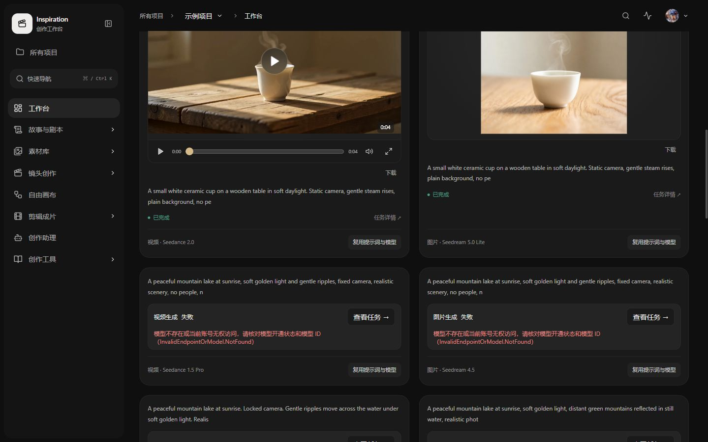
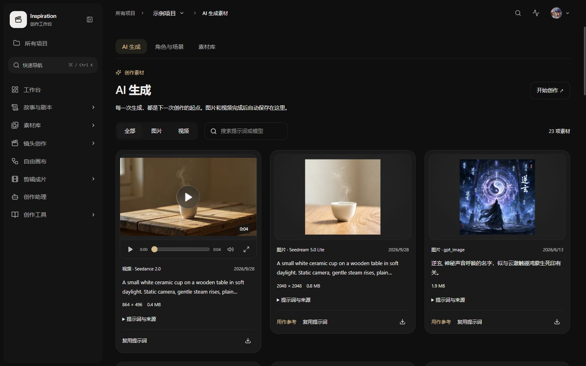
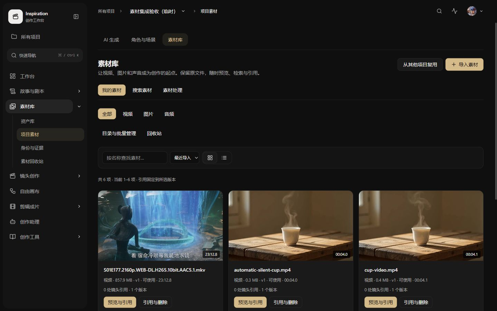
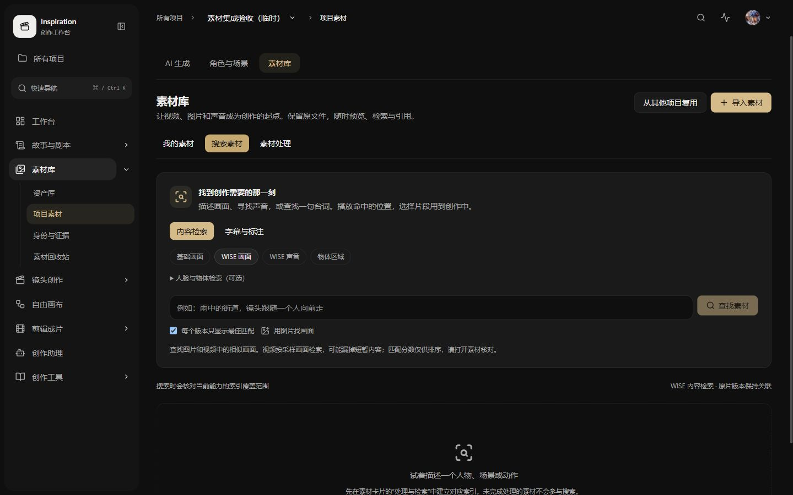
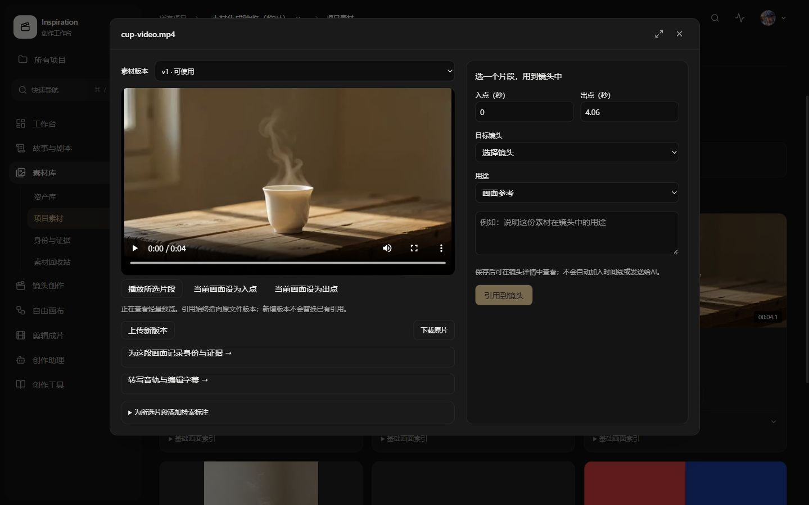
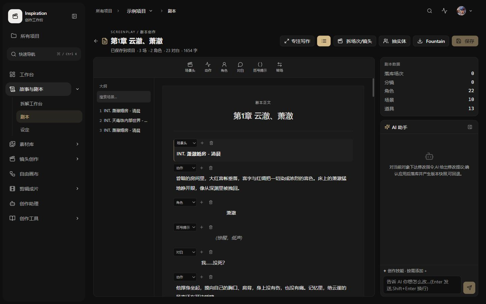
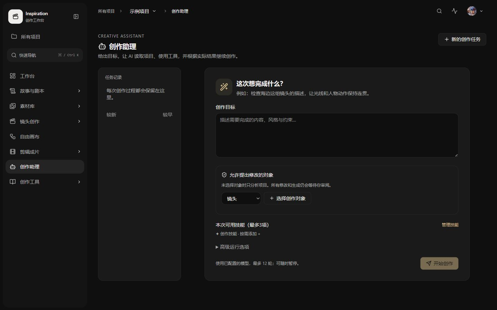
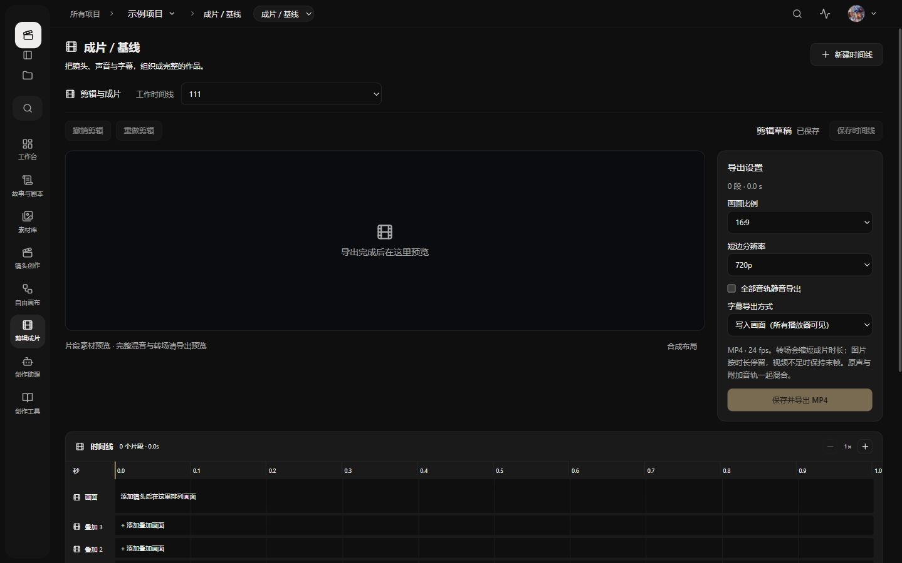
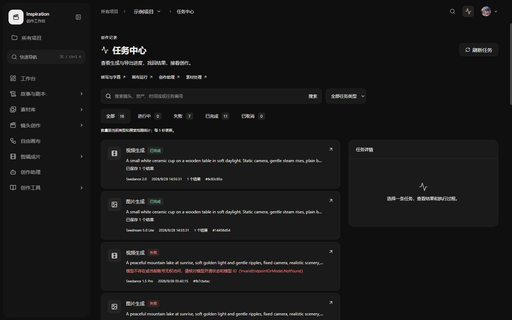
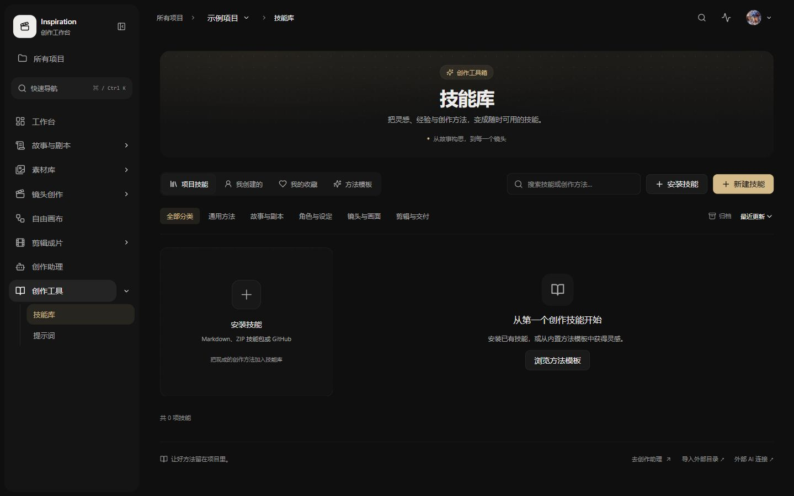

# Inspiration 页面交互问题清单

检查日期：2026-10-13。范围：本地 main 工作区 `C:/Code/Python/inspiration`，浏览器 `127.0.0.1:5173`。

这轮实际打开页面、展开入口、查看现有内容，并对照代码；没有修改产品代码，没有提交生成、保存、删除或索引任务。结论是：用户截图中的问题确实重复出现，而且部分操作成本来自流程分散，单独修改卡片样式解决不了。

## 检查范围与证据

浏览器检查了项目列表、工作台、AI 生成素材、素材库列表与搜索、媒体预览弹窗、剧本列表与编辑器、创作助理、剪辑成片、任务中心、技能库、角色与场景列表及资产详情。使用示例项目与已有素材验收项目，在 1440 × 900 桌面视口观察，保留原有深色主题。

本文是第一轮问题定位，不代表全站功能验收。画布节点操作、模型配置、权限、移动端、键盘无障碍、失败重试、收费生成与真实检索质量没有在本轮完整验证。未看到的问题不等于没有问题。

优先级：**P1** 影响找到内容、完成主流程或判断操作结果；**P2** 增加理解与浏览成本。不是故障事故等级。表内“现场”指实际页面及 DOM；“代码”指静态证据，未伪装成现场复现。

## 问题总表

| 编号 | 页面/位置 | 已观察到的问题 | 对用户的影响 | 优先级/证据 |
| --- | --- | --- | --- | --- |
| U01 | 工作台 → 最近创作 | 两列大卡片套媒体边框；视频控制条另外占一行；下载、提示词、状态、任务详情分散 | 同屏可比较结果少，视线要来回找操作；就是用户截图中的问题 | P1 · 现场+代码 |
| U02 | 工作台 → 最近创作/继续创作 | 成功与失败任务混排，项目“继续创作”和阶段入口位于这批历史卡片之后 | 返回项目时先翻历史，再找当前工作 | P1 · 现场+代码 |
| U03 | AI 生成素材 | 旧记录显示“图片暂不可用”、0.0 MB，但仍展示原图、下载等入口；部分还有“用作参考” | 不清楚是预览坏了、文件失效，还是仍能使用 | P1 · 现场；未点击验证下载，不认定文件已丢失 |
| U04 | 素材库 → 我的素材 | 横向素材分类、页面标题、工作模式、媒体类型、目录管理、搜索排序连续堆叠；首行素材约在视口 y=550 才出现 | 看素材之前先看大量管理界面 | P1 · 现场 |
| U05 | 素材库 → 搜索素材 | 要先理解“基础画面 / WISE 画面 / WISE 声音 / 物体区域”和“每个版本只显示最佳匹配” | 用户想描述内容，却先要判断检索实现与数据结构 | P1 · 现场+代码 |
| U06 | 素材搜索 → 未建索引说明 | 提示去素材卡片的“处理与检索”建立索引；未处理素材不会参与搜索 | 搜不到时需要退出搜索、找卡片、选处理；当前搜索范围是否完整不直观 | P1 · 现场+代码 |
| U07 | 素材库 → 预览 | 预览弹窗同时展示版本、裁切时间、上传版本、身份记录、字幕、目标镜头、引用角色与备注 | 只想看视频也要面对编辑关系的表单 | P2 · 现场 |
| U08 | 素材库 → 引用到镜头 | 页面明确说明不会自动加入时间线或发送给 AI | “我把这段用进作品”仍需其他步骤；引用的实际作用与用户预期容易错位 | P1 · 现场+代码；不是按钮实现故障 |
| U09 | 剧本编辑器 | 导航、场次大纲、正文、统计与 AI 面板并列；正文各块常驻类型选择、添加和删除按钮 | 写作区域被挤压，阅读时不断遇到编辑控件 | P1 · 现场 |
| U10 | 剧本编辑器 → 统计 | 顶部显示正文中的场次/角色，右侧同时显示“落库场次”和项目资产数；本次出现顶部 3 场/2 角色、右侧 0 场次/22 角色 | 统计口径不清楚，容易误以为拆解或保存失败 | P1 · 现场+代码；不是证明数据计数错误 |
| U11 | 创作助理 → 新任务 | 目标之外还需理解可修改对象、对象类型、技能；未选择对象只分析；历史在独立任务记录内 | 自然语言目标和项目中正在编辑的对象之间还需要用户手工搭桥 | P1 · 现场；对象选择器已有搜索/分批加载，不应推倒重做 |
| U12 | 剪辑成片 → 空时间线 | 大预览区域与导出设置先占首屏，“添加镜头”的选择器在时间线轨道之后 | 第一次进来最需要的“加第一个镜头”反而不突出 | P1 · 现场 |
| U13 | 剪辑成片 → 预览说明 | 页面写明片段可预览，完整混音与转场需导出预览 | 用户判断整片效果要经过导出，编辑反馈周期较长 | P1 · 现场文案；未运行导出性能测试 |
| U14 | 任务中心 | 另列转写、画布运行、创作助理、素材处理入口，各自跳到别页 | “找我的任务”仍要求知道任务属于哪个模块；不是一个完整的统一进度入口 | P1 · 现场+代码 |
| U15 | 任务中心 → 历史失败记录 | 部分错误原样展示 HTTP 504 的 HTML 标签或 HTTP 400 文本 | 用户能看到错误，但不知道应该改什么、是否可重试 | P1 · 现场+代码 |
| U16 | 资产详情 → 信息 | “保存 / 提交版本 / 锁定 / 删除”相邻；名称简介手动保存，标签回车即时保存 | 同页不同保存规则；“保存了”和“提交版本了”关系难理解 | P1 · 按钮现场确认；保存行为由代码确认，未写入数据 |
| U17 | 素材相关导航 | 侧栏叫“素材库”，默认进“资产库”；子项叫“项目素材”；页面内又用“角色与场景 / 素材库 / AI 生成” | 同一个内容区域有多套分类和名字；用户难判断生成物、文件和角色设定分别在哪 | P1 · 现场+代码 |
| U18 | 工作台 → 章节范围 | 示例项目的原生下拉包含 1765 个章节选项，没有内置搜索框 | 大项目中定位章节困难；短列表控件不适合真实数据规模 | P1 · 现场 DOM+代码 |
| U19 | 技能库 → 空状态 | 没有项目技能时仍完整展示范围标签、分类、归档、排序；安装有两处入口，另有新建和模板 | 新用户先做分类决策，再理解如何获得第一个可用技能 | P2 · 现场；已有安装入口，不能再描述成“未实现安装” |
| U20 | 资产详情 → 请求/保存失败 | 无资产数据统一走“加载中”；保存等 mutation 在本组件缺少错误展示，按钮未按提交中禁用 | 请求出错时可能一直像加载，保存失败缺少可见反馈 | P1 · 仅代码确认，未人为制造失败 |

## 页面证据与复现路径

### A. 工作台与生成素材：媒体展示没有形成统一规则

进入示例项目工作台，向下到“最近创作”。本次六条最近记录包含两条成功与四条失败，巨大媒体卡片与失败信息共同占据页面。生成素材页密度比工作台更好，但同样受到媒体容器、额外控制条和不同内容高度影响。

来源：[结果卡片样式](../../frontend/src/components/workbench/composer.css)、[共享媒体样式](../../frontend/src/components/media-preview.css)、[生成素材页](../../frontend/src/pages/GeneratedLibrary.tsx)、[工作台](../../frontend/src/pages/Workbench.tsx)、[章节选择器](../../frontend/src/components/workbench/WorkbenchGallery.tsx)。关键位置：composer.css 第 585 行起，media-preview.css 第 16、73、128 行附近，WorkbenchGallery.tsx 第 159–178 行。

需要先定的规则：缩略卡、播放详情、任务详情分别承担什么；默认只保留与当前目标有关的主操作。图片完整预览时应保留原比例，列表缩略展示与完整预览不必共用一套尺寸策略。

### B. 素材列表、搜索与预览：一个简单目标被拆成太多技术步骤

进入已有文件的素材库，依次查看“我的素材”“搜索素材”，再点视频缩略图。无需运行索引即可看到 U04–U08。

卡片还并列“预览与引用”“引用与删除”“处理与检索”：同一个“引用”出现在两个不同入口，删除影响管理与常用操作处于同一层。技术能力确实存在，但需要用户自己组装操作路径。

来源：[素材库](../../frontend/src/pages/MediaLibrary.tsx) 第 553、600、1095 行附近；[搜索](../../frontend/src/components/LibrarySearch.tsx) 第 350、548、828 行附近。

需要先定的规则：找内容时默认跨可用索引查询，明确未处理覆盖范围；“预览”“用作参考”“加入剪辑”表达不同目的，分别给出明确的完成反馈。

### C. 剧本和创作助理：编辑上下文与 AI 工作上下文分离

进入现有剧本，观察正文块控件和两套统计；再从侧栏打开创作助理，查看新任务表单。本轮仅打开对象选择器并以零选择关闭，未创建助理任务。

“抽实体”“落库场次”“Fountain”等名称需要背景知识。顶部实时正文统计与右侧派生对象/项目资产统计可以共存，但应明确范围，不能看起来像同一份作品的相互矛盾结果。AI 侧栏也不应在没有任务时长期挤占正文宽度。

来源：[剧本编辑器](../../frontend/src/pages/ScriptEditor.tsx) 第 76、178、714 行附近；[创作助理](../../frontend/src/pages/Agent.tsx) 第 361–468 行；[对象 AI 面板](../../frontend/src/components/AssistPanel.tsx)。

本轮只能确认多个 AI 入口和不同上下文；不能仅凭界面断言 Agent 没有工具调用能力，也不能据此判断它“是假的”。

### D. 剪辑与任务：流程顺序和进度归属让用户额外思考

剪辑页打开已有但为空的时间线。虽然处于零片段状态，先展示导出参数；添加第一个镜头的操作在更下方。标题“成片 / 基线”也比侧栏“剪辑成片”更偏内部概念。

任务中心已有类型筛选、状态数量和详情，不属于完全没整理。但另外四类任务仍引到别页，失败信息也仍有原始错误透出。

来源：[成片页](../../frontend/src/pages/Cuts.tsx)、[时间线编辑](../../frontend/src/components/TimelineStudio.tsx)、[任务中心](../../frontend/src/pages/Tasks.tsx) 第 190、356、643 行附近。

需要先定的规则：空状态先引导第一步；完整播放反馈与最终导出如何区分；任意后台操作都能在一个地方找到状态，并返回原工作位置。

### E. 技能、资产详情与导航：术语和保存方式不一致

技能库本轮为空，视觉秩序好于大型结果卡片，但空状态仍保留了整套管理操作。这个页面的问题优先级低于素材检索、编辑保存和主流程衔接。

资产列表点击名称先打开快速预览，再点“打开完整详情”进入信息表单，现场确认保存、提交版本、锁定、删除四个操作。截图捕获未成功，因此此处以 DOM 观察和源码为证，不附假截图。

来源：[技能库](../../frontend/src/pages/Skills.tsx)、[资产详情](../../frontend/src/pages/AssetDetail.tsx)、[素材标签](../../frontend/src/components/MaterialTabs.tsx)、[导航分组](../../frontend/src/lib/workspace-stages.ts)。

AssetDetail.tsx 第 31–34、64–97、111、187 行附近：标签即时请求，名称简介另行保存；查询没有单独错误视图，多个 mutation 没有组件级错误反馈。这里只定位风险，没有把它写成已经复现的数据丢失。

## 建议的后续整理顺序（尚未实施）

1. **先明确作品主流程与对象关系。** 用户正在做哪个作品、用了哪些素材、AI 正在替它完成什么、下一步在哪里。先解决 U08、U11、U14、U17。
2. **再统一高频浏览与选择。** 工作台结果、生成素材、素材库用一致的缩略、状态、主操作和详情规则；同时处理检索入口和大列表选择。
3. **统一编辑与保存反馈。** 明确哪些自动保存，哪些需要确认；分开保存、版本快照、锁定；先补失败和提交中状态。
4. **最后精简低频管理与视觉细节。** 版本、引擎、索引、归档、调试信息按需出现，再处理边框、留白、对齐和文案。

已有功能不能仅因为入口复杂就删除。本轮只留下问题与证据，下一阶段应先画出少量核心使用路径，再决定合并页面还是调整组件。

前一轮的全站代码与按钮目录见：[交互现状清单](2026-10-12-交互现状清单.md)、[控件索引 CSV](2026-10-12-controls.csv)。CSV 是源代码交互节点索引，包含条件显示和重复组件，不等于用户同时看到的按钮数量。
